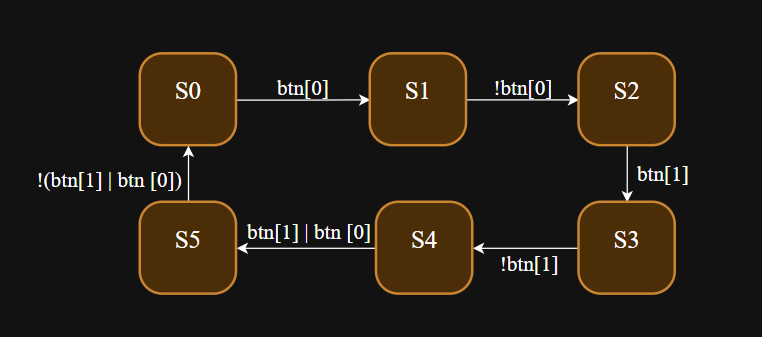
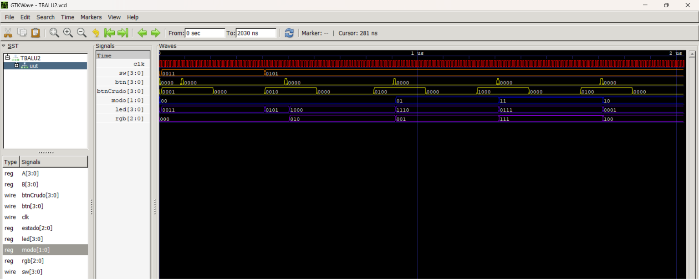
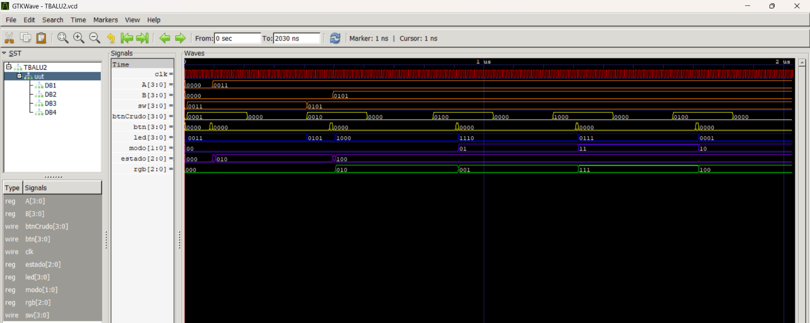

# Lab 2 - Diseño, simulación e implementación de una ALU de 4 bits

<hr style="height: 4px; border: none; background-color: #c0f0f4;">

### Integrantes 2026 - 2

**Grupo 4**

- Ana Lucía Molina López - 1061697969
- Nicolás Ramírez González - 1023371323
- Diana Margarita Castillo - 1011201869

## Índice

- [Lab 2 - Diseño, simulación e implementación de una ALU de 4 bits](#lab-2---diseño-simulación-e-implementación-de-una-alu-de-4-bits)
    - [Integrantes 2026 - 2](#integrantes-2026---2)
  - [Índice](#índice)
- [Funcionamiento del Sistema](#funcionamiento-del-sistema)
- [Arquitectura Propuesta](#arquitectura-propuesta)
- [Módulos Desarrollados](#módulos-desarrollados)
    - [Entradas y Salidas del Módulo `ALU2`](#entradas-y-salidas-del-módulo-alu2)
    - [Descripción de los Estados de la FSM](#descripción-de-los-estados-de-la-fsm)
    - [Lógica de Salida](#lógica-de-salida)
    - [Módulo `debounce`](#módulo-debounce)
- [Forma en que se Almacenan los Operandos](#forma-en-que-se-almacenan-los-operandos)
- [Forma en que se Conserva el Código de Operación](#forma-en-que-se-conserva-el-código-de-operación)
- [Operaciones Implementadas](#operaciones-implementadas)
- [Simulación GTKWave](#simulación-gtkwave)
- [Comportamiento Observado Durante la Simulación](#comportamiento-observado-durante-la-simulación)
- [Implementación Funcional en FPGA](#implementación-funcional-en-fpga)
- [Errores](#errores)
  - [Código punto](#código-punto)


# Funcionamiento del Sistema

El sistema consiste en una **Unidad Aritmético Lógica (ALU) de 4 bits** controlada mediante una **Máquina de Estados Finitos (FSM)** de 6 estados. 

El flujo de operación es el siguiente:
1. El usuario ingresa y almacena secuencialmente dos operandos de 4 bits (`A` y `B`) utilizando los conmutadores (`sw`) y los botones de control (`btnCrudo`), cuyas señales son filtradas por el módulo `debounce` antes de llegar a la FSM.
2. Una vez guardados los datos, se selecciona la operación a realizar conmutando los bits de la variable `modo` mediante botones.
3. El resultado final de la operación seleccionada se visualiza directamente en los LEDs (`led`), mientras que el LED RGB (`rgb`) indica mediante un código de colores la operación matemática o lógica que se está ejecutando.

---

# Arquitectura Propuesta

La arquitectura del sistema está compuesta por los siguientes bloques funcionales:

- **Acondicionamiento de Botones (`debounce`):** Cuatro instancias del módulo `debounce` (una por botón) que sincronizan la entrada, eliminan el rebote mecánico y entregan un pulso de un solo ciclo de reloj por cada pulsación.
- **Unidad de Control (FSM):** Secuenciador secuencial de 6 estados que gestiona la captura de datos, la prevención de falsos disparos por botones y la transición del flujo de ejecución.
  
  

- **Registros de Almacenamiento:** Registros internos dedicados a mantener estables los valores de los operandos `A` (4 bits), `B` (4 bits) y el código de operación `modo` (2 bits).
- **Bloque Combinacional de la ALU:** Módulo encargado de realizar las operaciones aritméticas (suma y resta) y lógicas (AND y OR bit a bit) entre los operandos `A` y `B`.
- **Lógica de Salida y Decodificación:** Lógica combinacional que conmuta las salidas:
  - En fase de captura, conmuta los LEDs (`led`) para reflejar la posición de los conmutadores (`sw`).
  - En fase de ejecución, muestra en los LEDs el resultado calculado por la ALU y activa el color correspondiente en el LED RGB (`rgb`).

---

# Módulos Desarrollados

### Entradas y Salidas del Módulo `ALU2`

| Señal | Tipo | Ancho de Bit | Descripción |
| :--- | :---: | :---: | :--- |
| `clk` | Entrada | 1 | Reloj principal del sistema. |
| `sw` | Entrada | 4 | Conmutadores (switches) para el ingreso de datos. |
| `btnCrudo` | Entrada | 4 | Botones físicos sin filtrar. Cada uno pasa por un `debounce`, que genera la señal interna `btn[3:0]` (pulso de un ciclo) usada por la FSM para navegación y selección de modo. |
| `led` | Salida | 4 | LEDs para visualización de entrada en tiempo real o resultado de la ALU. |
| `rgb` | Salida | 3 | LED RGB para indicación del modo de operación seleccionado. |

---

### Descripción de los Estados de la FSM

La FSM consta de 6 estados principales gestionados en el bloque secuencial:

- **Estado 0 (`3'd0`):** Espera la pulsación de `btn[0]`. Al presionarlo, guarda el valor presente en `sw` dentro del registro `A` y avanza al Estado 1.
- **Estado 1 (`3'd1`):** Espera a que se libere `btn[0]`. Funciona como una etapa de sincronización/anti-rebote antes de pasar al Estado 2.
- **Estado 2 (`3'd2`):** Espera la pulsación de `btn[1]`. Al presionarlo, guarda el valor de `sw` dentro del registro `B` y avanza al Estado 3.
- **Estado 3 (`3'd3`):** Espera la liberación de `btn[1]` para evitar saltos indeseados, avanzando posteriormente al Estado 4.
- **Estado 4 (`3'd4`):** Estado de ejecución y selección de operación.
  - Si no se presiona `btn[0]` ni `btn[1]`, permite alternar los bits del registro `modo`: `btn[2]` conmuta el bit `modo[0]` y `btn[3]` conmuta el bit `modo[1]`.
  - Si se presiona `btn[0]` o `btn[1]`, transiciona hacia el Estado 5 para iniciar el reinicio del flujo.
- **Estado 5 (`3'd5`):** Espera a que se liberen completamente los botones `btn[0]` y `btn[1]` para reiniciar la FSM al Estado 0.

> Como `debounce` entrega `btn[x]` como un pulso de un solo ciclo de reloj, los Estados 1, 3 y 5 (que esperan la liberación del botón) duran en la práctica un único ciclo, por lo que en la forma de onda se ven como cambios casi instantáneos de `estado`.

---

### Lógica de Salida

La asignación de las salidas es puramente combinacional (`always @(*)`):

- **Estados 0, 1, 2 y 3:** La salida `led` refleja en tiempo real la posición física de los switches (`led = sw`). El LED RGB permanece apagado (`rgb = 3'b000`).
- **Estados 4 y 5:** La salida `led` muestra el resultado calculado por la ALU sobre los registros `A` y `B`, según el valor guardado en `modo`. Simultáneamente, la salida `rgb` se enciende con el color asociado a la operación.

---

### Módulo `debounce`

Módulo auxiliar instanciado cuatro veces dentro de `ALU2` (`DB1` a `DB4`), una por cada bit de `btnCrudo`. Su funcionamiento es el siguiente:

1. **Sincronizador:** dos flip-flops en serie (`s0`, `s1`) llevan la señal asíncrona del botón al dominio del reloj.
2. **Filtro de rebote:** un contador (`cnt`) se incrementa mientras la señal sincronizada `s1` sea distinta del valor filtrado `stable`. Si `s1` vuelve a coincidir con `stable`, el contador se reinicia. Solo cuando `s1` se mantiene distinto durante `CNT_MAX` ciclos consecutivos, `stable` toma el nuevo valor.
3. **Generación del pulso:** en el instante en que `stable` pasa a 1 (flanco de subida filtrado), `pulse` se activa durante un único ciclo de reloj. La liberación del botón no genera pulso.

| Señal | Tipo | Ancho de Bit | Descripción |
| :--- | :---: | :---: | :--- |
| `clk` | Entrada | 1 | Reloj principal del sistema. |
| `btn_in` | Entrada | 1 | Botón sin filtrar (`btnCrudo[x]`). |
| `pulse` | Salida | 1 | Pulso de un ciclo por cada pulsación válida (`btn[x]`). |

El parámetro `CNT_MAX = 1_250_000` equivale a unos 10 ms con un reloj de 125 MHz.

---

# Forma en que se Almacenan los Operandos

Los operandos se almacenan de forma síncrona en **registros internos tipo Flip-Flop D** de 4 bits (`reg [3:0] A` y `reg [3:0] B`). 

- La captura del **Operando A** ocurre en el **Estado 0** en el flanco de subida de reloj (`posedge clk`) cuando la señal `btn[0]` (pulso ya filtrado por `debounce`) está activa (`A <= sw`).
- La captura del **Operando B** ocurre en el **Estado 2** de forma equivalente mediante la señal `btn[1]` (`B <= sw`).

---

# Forma en que se Conserva el Código de Operación

El código de operación se conserva mediante un registro interno de 2 bits (`reg [1:0] modo`).

En el **Estado 4**, la operación deseada se configura conmutando (negando) sus bits individuales mediante asignaciones no-bloqueantes síncronas al reloj:
- Presionar `btn[2]` conmuta el bit de menor peso (`modo[0] <= ~modo[0]`).
- Presionar `btn[3]` conmuta el bit de mayor peso (`modo[1] <= ~modo[1]`).

El valor se mantiene retenido en este registro hasta que se vuelva a modificar manualmente con estos botones. Al terminar el flujo (Estado 5 → Estado 0) el registro `modo` **no** se reinicia, por lo que al cargar nuevos operandos se conserva la última operación seleccionada. El bloque `default` de la FSM (que pone `estado`, `A`, `B` y `modo` en 0) solo se ejecuta si `estado` toma un valor no válido (6, 7 o indefinido al inicio de la simulación); no es alcanzable mediante los botones.

---

# Operaciones Implementadas

| Operación | Expresión Verilog | Valor `modo` | Código `rgb` (`3'bRGB`) | Color LED RGB |
| :---: | :---: | :---: | :---: | :---: |
| **Suma** | `A + B` | `2'b00` (`0`) | `3'b010` | Verde (G) |
| **Resta** | `A - B` | `2'b01` (`1`) | `3'b001` | Azul (B) |
| **AND** | `A & B` | `2'b10` (`2`) | `3'b100` | Rojo (R) |
| **OR** | `A \| B` | `2'b11` (`3`) | `3'b111` | Blanco (RGB) |

---

# Simulación GTKWave



[Codigo simulación](codigos/códigos/TBALU2.v)

---

# Comportamiento Observado Durante la Simulación



> En la forma de onda se observa el proceso de captura de los operandos `A` y `B`: mientras la FSM está en los Estados 0 a 3, el bus `led[3:0]` sigue a los switches (`sw`), y los pulsos de `btn[0]` y `btn[1]` cargan `A = 0011` y `B = 0101`. Cada pulso de `btn[x]` aparece unos ciclos después de que sube `btnCrudo[x]`, por el tiempo que tarda el `debounce` en validar la pulsación. Posteriormente, con la FSM en el Estado 4, los pulsos de `btn[2]` y `btn[3]` modifican de forma secuencial el registro `modo[1:0]` (operaciones Suma 00, Resta 01, OR 11 y AND 10). A su vez, el LED RGB (`rgb[2:0]`) actualiza su color y `led` muestra el resultado (8, E, 7 y 1 respectivamente) para reflejar la operación activa en cada intervalo.


---

# Implementación Funcional en FPGA


[Video con la demostración](https://drive.google.com/file/d/1BL0Tof1RyYyNOwMiS0ND_HPc_P3cV5ED/view?usp=sharing "Video, entrar con el correo institucional")
> Video del funcionamiento.

# Errores

Al implementar la ALU en la FPGA con la señal de reloj principal del sistema, se observaron breves destellos indeseados (glitches) en el led RGB durante las transiciones de estado. Este fenómeno ocurre porque la FSM evalúa las entradas de los botones (btn) en cada flanco activo sin un mecanismo de sincronización o filtrado previo. Dado que los pulsadores mecánicos generan múltiples oscilaciones metálicas al ser presionados (efecto rebote), la FSM a alta frecuencia interpreta estas vibraciones como múltiples pulsaciones consecutivas en cuestión de microsegundos, causando saltos de estado imprevistos y estados transitorios visibles en los LEDs.

Para corregirlo se agregó el módulo `debounce` (ver [Módulo `debounce`](#módulo-debounce)): la FSM ya no lee el botón físico `btnCrudo[x]`, sino la señal `btn[x]`, que es un pulso de un solo ciclo generado solo después de que el botón permanece estable `CNT_MAX` ciclos.

En la simulación con Icarus Verilog y GTKWave no existe el rebote mecánico, pero la estructura de la FSM impone una restricción sobre la duración de la señal que recibe. En el Estado 4, la conmutación de los bits de modo se realiza mediante asignaciones no bloqueantes (<=) condicionadas por una cadena `else-if`:

```verilog
3'd4: if (btn[0] | btn[1]) estado <= 3'd5;
      else if (btn[2]) modo[0] <= ~modo[0];
      else if (btn[3]) modo[1] <= ~modo[1];
```

Si la señal `btn[3]` permaneciera activa durante más de un ciclo completo de reloj, la FSM volvería a negar `modo[1]` en el siguiente flanco ascendente, provocando que el registro regrese inmediatamente de 11 a 01 antes de poder estabilizarse y graficarse. Este caso no ocurre en el diseño final porque `debounce` entrega siempre un único ciclo de pulso, sin importar cuánto tiempo se mantenga presionado el botón.

Esto tiene una consecuencia directa sobre el testbench: como el pulso solo se genera después de ver el botón estable durante `CNT_MAX` ciclos (1 250 000 en hardware), un estímulo de pocos nanosegundos (por ejemplo `#10`) nunca produce un `btn[x]`. Por eso en `TBALU2.v`:

- Se reduce `CNT_MAX` a 5 en las cuatro instancias mediante `defparam` (`uut.DB1.CNT_MAX` a `uut.DB4.CNT_MAX`), solo para la simulación, evitando simular más de 12 ms por cada pulsación.
- Cada botón de `btnCrudo` se mantiene 200 ns en alto y 200 ns en bajo (20 ciclos, mayor que `CNT_MAX`), de modo que `debounce` detecte tanto la pulsación como la liberación; sin la liberación, `stable` quedaría en 1 y la siguiente pulsación del mismo botón no se reconocería.

Con esto cada pulsación genera exactamente un pulso de un ciclo en `btn[x]`, permitiendo la acumulación limpia de los bits hasta obtener el modo 11 y posteriormente el 10.


## Código punto 
```verilog
module ALU2 (
    input clk,
    input [3:0] sw,
    input [3:0] btnCrudo,
    output reg [3:0] led,
    output reg [2:0] rgb
);
    reg [2:0] estado;
    reg [3:0] A;
    reg [3:0] B;
    reg [1:0] modo;
    wire [3:0] btn;

    debounce DB1 (
        .clk   (clk),
        .btn_in(btnCrudo[0]),
        .pulse (btn[0])
    );

    debounce DB2 (
        .clk   (clk),
        .btn_in(btnCrudo[1]),
        .pulse (btn[1])
    );

    debounce DB3 (
        .clk   (clk),
        .btn_in(btnCrudo[2]),
        .pulse (btn[2])
    );

    debounce DB4 (
        .clk   (clk),
        .btn_in(btnCrudo[3]),
        .pulse (btn[3])
    );

    always @(posedge clk) begin
        case (estado)
            3'd0: if (btn[0]) begin
                A <= sw;
                estado <= 3'd1;
            end
            3'd1: if (!btn[0]) estado <= 3'd2;
            3'd2: if (btn[1]) begin
                B <= sw;
                estado <= 3'd3;
            end
            3'd3: if (!btn[1]) estado <= 3'd4;
            3'd4: if (btn[0] | btn[1]) estado <= 3'd5;
                else if (btn[2]) modo[0] <= ~modo[0];
                else if (btn[3]) modo[1] <= ~modo[1];
            3'd5: if (!(btn[0] | btn[1])) estado <= 3'd0;
            default: begin
                estado <= 0;
                A <= 0;
                B <= 0;
                modo <= 0;
            end
        endcase
    end

    always @(*) begin
        rgb = 0;
        case (estado)
            3'd0, 3'd1, 3'd2, 3'd3: led = sw;
            3'd4, 3'd5: begin
                case (modo)
                    2'd0: begin
                        led = A+B;
                        rgb = 3'b010;
                    end
                    2'd1: begin
                        led = A-B;
                        rgb = 3'b001;
                    end
                    2'd2: begin
                        led = A&B;
                        rgb = 3'b100;
                    end
                    2'd3: begin
                        led = A|B;
                        rgb = 3'b111;
                    end
                    default: begin
                        led = A+B;
                        rgb = 3'b010;
                    end 
                endcase
            end
            default: begin
                led = 0;
                rgb = 0;
            end
        endcase
    end
endmodule

```

